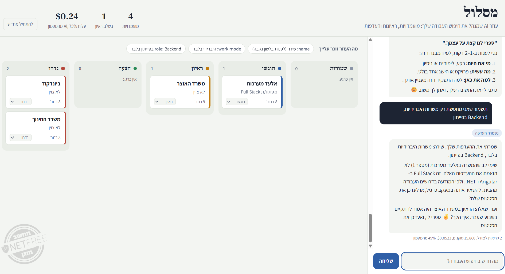

# Maslul: an AI agent for managing a job search

**Maslul** (Hebrew for *track*, *path*) is an AI assistant that keeps track of a job search.
You tell it what happened in plain language ("Wix invited me to an interview"), and it updates
your applications board, remembers your preferences between sessions, and reads job postings from the web.



The agent was built **twice**: once on the raw Claude Messages API with a harness written from
scratch, and once on the Claude Agent SDK. Both versions run the same scenario and are measured
side by side (tokens, cache hit rate, cost, time, lines of code).

## Features

- **Chat in Hebrew** with an agent that uses 5 tools: add an application, update a status, list
  applications, save a preference, and fetch a job posting from the internet
- **Long-term memory**: preferences survive between sessions, and the agent flags requests that
  contradict them instead of silently overwriting them
- **Kanban board** (saved, applied, interview, offer, rejected) that updates live when the agent
  changes something; cards can also be dragged between stages
- **Cost transparency**: every answer shows its model calls, tokens, cost and cache hit rate
- **20 offline tests** with a fake model client (no API key needed)

## Two harnesses, one agent

| Responsibility | `API/` (written by hand) | `SDK/` (configured) |
|---|---|---|
| Agent loop | `loop.py`: runs while `stop_reason == "tool_use"`, all tool results returned in one message | `client.query()` + `receive_response()` |
| Tools | `tools.py`: JSON schemas, dispatch, errors returned as `is_error` | `@tool` + `create_sdk_mcp_server` |
| Conversation | `history.py`: append-only JSONL on disk | `resume=session_id` |
| Memory | `memory.py`: compact preferences injected every turn | `CLAUDE.md` loaded with `setting_sources=["project"]` |
| Context | `context.py`: static system prompt + a one-line state summary, details pulled with tools | custom `system_prompt` |
| Context window | `compaction.py`: summarizes the conversation above a threshold | automatic |
| Prompt caching | `caching.py`: breakpoints on tools, system prompt and last message | automatic |
| Tokens and cost | `tokens.py`: usage and cost per call and per turn | `ResultMessage.usage`, `total_cost_usd` |

The domain code (tools and data) lives in `shared/` and is used by both versions.

## Results

Same model (`claude-opus-5-5`) and effort (`medium`), 7 turns over 2 sessions, 7 pass/fail checks.

| | API | SDK |
|---|---:|---:|
| Checks passed | 7/7 | 7/7 |
| Model calls | 12 | 14 |
| Cache hit rate | 87.5% | 92.8% |
| Cost | $0.058 | $0.075 |
| Time | 29 s | 37 s |
| Harness lines of code | 322 | 40 |

The SDK cost more mainly because Claude Code writes to the 1-hour prompt cache ($8/M tokens instead
of $5/M) and adds its own instructions to every call. The full analysis is in [REPORT.md](REPORT.md) (Hebrew).

## Run it

Requires Python 3.11+.

```bash
git clone https://github.com/Shira-Berkovitz/maslul-job-search-agent.git
cd maslul-job-search-agent
python -m venv .venv
.venv\Scripts\Activate.ps1          # Windows (macOS/Linux: source .venv/bin/activate)
pip install -r requirements.txt
```

**Tests** (offline, no key):
```bash
python -m pytest -q tests
```

**Web app** (needs an Anthropic API key):
```bash
$env:ANTHROPIC_API_KEY="sk-ant-..."   # macOS/Linux: export ANTHROPIC_API_KEY=...
python web/server.py
```
Then open http://127.0.0.1:8765

**Benchmark scenario**:
```bash
python API/main.py --scenario scenario.json --out results/api.json
python SDK/main.py --scenario scenario.json --out results/sdk.json   # uses your Claude Code login, no API key
```

## Project structure

```
shared/      domain code: applications store, memory, tools, checks, pricing
API/         agent on the raw Messages API + harness/ (one file per responsibility)
SDK/         the same agent on the Claude Agent SDK
web/         FastAPI server + single-page web app
tests/       offline tests with a fake client
scenario.json, results/, REPORT.md   benchmark scenario, measurements and report
```

## What I learned

- **How an agent works under the hood**: the tool-use loop, returning tool errors to the model
  instead of crashing, and keeping state on disk so a new session can pick up where the last one stopped.
- **Context engineering pays off**: injecting a one-line summary instead of the full data, and letting
  the model pull details with tools, keeps every call small.
- **Caching is most of the cost story**: with a static system prompt and cache breakpoints, 87% of the
  input came from the cache, at 5% of the normal input price.
- **A framework saves code but hides decisions**: the SDK needed 40 lines instead of 322, but it chose
  the cache lifetime, added its own context, and reported cost in ways I had to verify by hand.

## Tech

Python, Claude Messages API, Claude Agent SDK, FastAPI, vanilla HTML/CSS/JavaScript, pytest.
